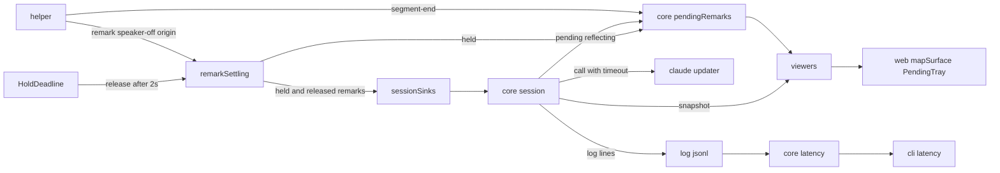
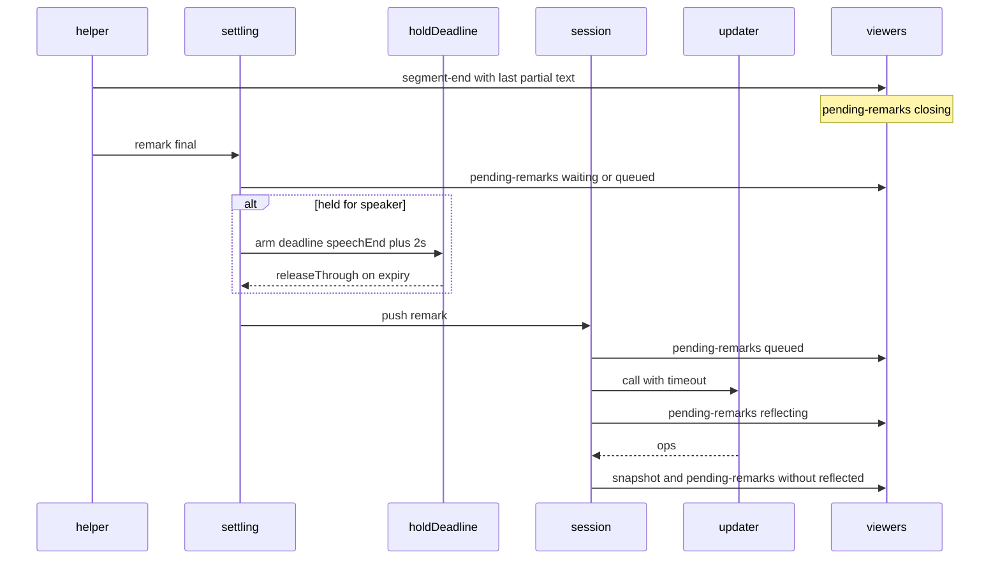
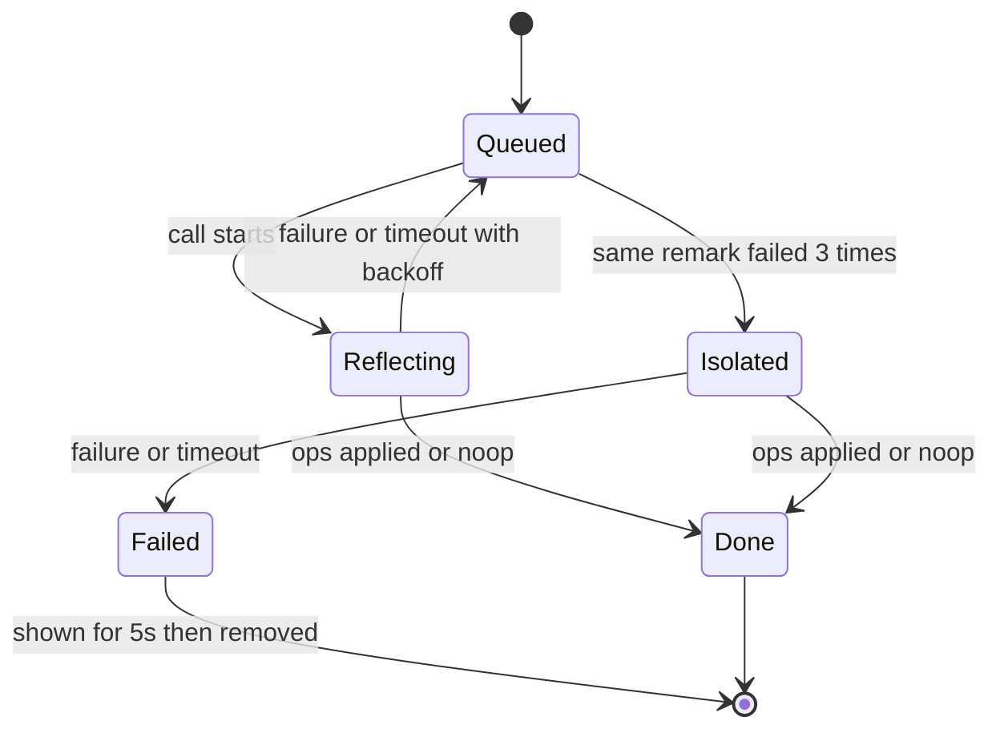

# Design Document: map-update-latency

## Overview

**Purpose**: 会議の主催者が、話し終えてから 1 秒以内に「いまの発言がマップに取り込まれようとしている」ことをマップの上で見られ、ノードの反映を中央値 3 秒・p90 5 秒以内に見られるようにする。マップの組み立ての質は落とさない。

**Users**: 会議の主催者（会議中のマップ）と、閲覧の共有で見る他の端末。保守者は遅れの集計で目標を確かめる。

**Impact**: 今は話し終えてから反映まで中央値 4.4 秒・p90 11 秒（`research.md` の実測）。相手の発言は、外した話者分離の待ちで 4〜43 秒止まる。この設計は、(1) 発言を際限なく待たせる箇所を除き、(2) helper の詰まりを抑え、(3) 失敗で発言を落とさないようにし（落とすのは要件 3.5 の 1 通りだけ）、(4) 区切りを先に知らせて取り込み待ちをマップの上に出し、(5) 呼び出しの調整を評価付きで入れられるようにし、(6) 遅れを記録・集計できるようにする。

**進め方**: 最初のタスクは、Agent SDK で Sonnet 5.5 の思考を切れるかと、そのときの速さ・質を確かめる試し（Spike）にする。その結果で中央値 3 秒の見込みが立つかを主催者と確かめてから、残りのタスクに進む（Checkpoint。下の「実装の順序」）。

### Goals
- 取り込み待ちの表示: 話し終えてから 1 秒以内（1.1）
- ノードの反映: 中央値 3 秒・p90 5 秒以内（2.1, 2.2）
- どの発言も 2 秒を超えて留めない・失わない（3.1〜3.4）。同じ発言が続けて失敗するときだけ、知らせて外す（3.5）
- 速くするための変更は、流し直しの評価で同等以上のときだけ既定にする（4.1〜4.3）
- 遅れを区間ごと・トラックごとに集計できる（5.1〜5.4）

### Non-Goals
- 差分操作の途中適用（応答のストリーミングを読みながら当てる）・差分更新の並列化・プロンプトの縮小（`research.md` の Simplification）
- 字幕（途中結果）の表示と速さの変更
- 差分更新のモデルを、質を落として替えること
- 話者分離そのもの（`speaker-attribution`）

## Boundary Commitments

### This Spec Owns
- 確定した発言を差分更新へ渡すまでの「留め」の上限（壁時計 2 秒）と、上限を超えたときの解放
- helper が話者分離を持たないときに、それを `speaker-off` で表明すること
- helper の途中結果のデコードが確定結果を遅らせないための抑え
- helper が VAD で区間を閉じた時点で、確定結果のデコードより先に `segment-end` で知らせること
- 差分更新の呼び出しの時間切れと、失敗した回の発言を落とさずに次へ回すこと（ログの `requeued` と restore の扱いを含む）。3 回続けて失敗した発言を 1 つだけで試し、それでも失敗したら外すこと
- 取り込み待ちの発言のフレーム（`pending-remarks`）とその中身の規則、マップの上の表示
- 差分更新の調整（思考・effort）の値と、その既定を評価付きで替える手順
- 遅れの記録の項目（origin の壁時計、発言の締まった時刻・表示した時刻）と集計（`cli latency`）

### Out of Boundary
- 話者を声で分けること、話者の待ちを 2 秒の内側に収めること（`speaker-attribution` が持つ。この仕様は上限を張るだけ）
- 字幕の吹き出し・途中結果の間引き（今のまま）
- マップの移動アニメ（`MOTION_DURATION_MS`）の長さ。表示の時刻はフレームを送った時刻で測る
- 閲覧の共有の回線の遅れ
- 差分操作の中身の規則・プロンプトの文面

### Allowed Dependencies
- helper → server: 既存の WebSocket のイベントの形（`server/src/core/live.ts`）。足すのは origin の任意の項目 `wallTime` と、新しいイベント `segment-end` だけ。server は知らない type を読み飛ばす（`live.ts:73-89`）ので、古い server に新しい helper をつないでも壊れない
- server の外側 → core: 既存の向きのまま。新しい core のモジュールは `effect` 本体だけに依存する
- web → server: core の barrel（`PendingRemarksFrame` の Schema）だけ
- 差分更新: Claude Agent SDK `query()` の既存の呼び方。足すのは `thinking` の設定だけ

### Revalidation Triggers
- `pending-remarks` のフレームの形を変える → web の liveFeed・mapSurface と閲覧の共有を確かめ直す
- origin・remark・diff のログの項目を変える（`requeued` の意味を含む）→ `cli latency`・`cli review`・restore を確かめ直す
- `segment-end` の形や出す時点を変える → 取り込み待ちの仮の表示と、確定結果との突き合わせを確かめ直す
- 留めの上限（2 秒）を変える → `speaker-attribution` の話者待ちの前提を確かめ直す
- helper が `speaker-off` を出すのをやめる（話者分離を入れる）→ この仕様の 2 秒の上限が効いていることを確かめ直す
- 差分更新の調整の既定を替える → 流し直しの評価をやり直す

## Architecture

### Existing Architecture Analysis
- 発言の流れ: helper の確定結果 → `remarkSettling.ts`（`core/settle.ts` → `core/speakers.ts` の話者待ち）→ `core/session.ts` の `push` → `pending` → `startDiffIfReady` → 呼び出し（`claude.ts`）→ 当てて publish（`sessionFiles.ts`）→ `viewers.ts` → web
- `speakers.ts` の時計は音声の時刻だけで、壁時計を持たない（上流 ADR 0003: core はタイマーを持たない）。helper が話者のイベントを出さないので、相手の発言は毎回最大 3 秒以上（音声が届かなければ際限なく）保留される
- 差分更新は 1 本ずつ。呼び出しに時間切れが無く、失敗した回の発言は処理済みにして捨てる（`session.ts:623-626`）。restore も同じ前提で、`error` のある diff 行は渡した発言をすべて反映済みとして数える（`session.ts:253-255` の `consumeFresh`）。反映済みでない発言は restore で `pending` に戻る（`session.ts:331`）
- 自分のトラックは話し終えてから発言が締まるまで中央値 1.19 秒（VAD の閉じ 0.6 秒 + エコーキャンセル 0.15 秒 + 確定のデコード など）。確定結果を待ってから表示したのでは 1 秒に届かない。途中結果（`partial`）は同じ区間の `start` で server に届いている
- 字幕の盤（`core/captions.ts`）が、話者待ち・pending・reflecting の発言を吹き出しに出している。発言の ID と状態はフレームに無い

### Architecture Pattern & Boundary Map



**Architecture Integration**:
- Selected pattern: 既存の「純粋な core + 外側」の 2 層を保つ。時間（壁時計の期限）は外側の Fiber が持ち、core には「この発言まで出す」関数だけを足す
- New components rationale: `pendingRemarks`（フレームの中身の規則、純粋）、`latency`（集計、純粋）、`HoldDeadline`（壁時計の期限、外側）、`PendingTray`（web の表示）
- Steering compliance: core は Node に依存しない、`runPromise` を使わない、テストの層は接尾辞で分ける、web は core の barrel だけを読む

### Technology Stack

| Layer | Choice / Version | Role in Feature | Notes |
|-------|------------------|-----------------|-------|
| helper | C# / .NET 10、sherpa-onnx 1.13.8 | `speaker-off` と origin の壁時計を出す。途中結果のデコードを詰まり時に飛ばす。VAD の無音の長さを引数にする | 新しい依存なし |
| server | Node 22、Effect 4.0.1、Claude Agent SDK 0.3.288 | 留めの上限、呼び出しの時間切れと再試行、取り込み待ちのフレーム、遅れの記録と集計 | `query()` に `thinking` を足す |
| web | Foldkit 0.167、Tailwind v4 | マップの上の取り込み待ちの表示 | 新しい依存なし |
| Data | log.jsonl（追記のみ） | 遅れの時刻の項目を足す | 古いログは項目なしでも読める |

## File Structure Plan

### New Files
```
server/src/core/
├── pendingRemarks.ts   # 取り込み待ちのフレームの Schema と、held・pending・reflecting から中身を組む純粋関数
└── latency.ts          # log.jsonl の行から区間ごと・トラックごとの中央値と p90 を出す純粋関数（本文を読まない）
server/src/
└── holdDeadline.ts     # 話者待ちの発言に壁時計の期限を張る Fiber（Clock + Effect.sleep）。期限で settling の解放を呼ぶ
web/src/app/mapSurface/
└── pendingTray.ts      # マップの上の取り込み待ちの表示（view とその Message）
server/scripts/
└── thinkingSpike.ts    # 使い捨ての試し（Spike）。Agent SDK で思考を切れるかと速さを確かめる。結果は research.md に書き、試しが終われば消す
server/test/
├── pendingRemarks.test.ts
├── latency.test.ts
├── holdDeadline.test.ts      # TestClock で 2 秒の期限
└── diffRecovery.test.ts      # 失敗・時間切れで発言を戻す・3 回で 1 つだけ試す・restore で戻る
web/test/
└── pendingTray.story.test.ts
```

### Modified Files
- `helper/RunSession.cs` — 起動直後（origin の直後）に `speaker-off`（reason「モデルなし」）を送る。origin に `wallTime`（Unix ms、音声の時刻 0 に当たる壁時計）を足す
- `helper/Events.cs` — origin の `wallTime`、`speaker-off`・`segment-end` のイベント型
- `helper/Transcription/SherpaTranscriber.cs` — 待ち行列にたまった音声が `PartialBacklogLimit`（0.3 秒）を超えている間は途中結果のデコードを飛ばす。`MinSilenceDuration` をコンストラクタの引数にする。`Drain` で区間を取り出したら、確定のデコードの前に `segment-end` を出す
- `helper/Program.cs` — `run` に `--vad-silence <秒>`（既定 0.6、評価の後に替える）
- `server/src/core/live.ts` — origin の Schema に任意の `wallTime` を足す。`segment-end` を足す
- `server/src/core/speakers.ts` — `releaseThrough(remarkId)`: 指定の発言とそれより前の保留を、話者なしで出す関数を足す。時計の規則は変えない
- `server/src/remarkSettling.ts` — 保留に入った発言ごとに `holdDeadline` を張り、期限で `releaseThrough` を呼ぶ。preview に保留の一覧を出す（既存の `heldRemarks`）
- `server/src/core/session.ts` — 呼び出しの時間切れ（`DIFF_CALL_TIMEOUT_MS`）。失敗・時間切れの回の発言を `pending` の頭に戻し、間隔を延ばして再試行する（処理済みにしない）。その diff 行に `requeued: true` を残す。発言ごとの続けての失敗の回数を持ち、3 回で 1 つだけの呼び出しにする。pending・reflecting が変わるたびに取り込み待ちの通知を出す。remark 行に `settledAt`・`shownAt` を足す
- `server/src/core/session.ts`（restore）— `consumeFresh` は `requeued: true` の行を「反映した発言なし」として数える（`processedRemarks ?? 0`）。`requeued` の無い `error` の行は今と同じく全部を反映済みとする（3.5 で外した発言と古いログ）
- `server/src/core/session.ts`（`DiffEvent`）— diff 行に任意の `requeued`・`isolated` を足す
- `server/src/sessions.ts` — origin を受けたら `origin` 行（`wallTime`）をログに 1 回残す
- `server/src/sessions.ts` — `segment-end` を受けたら、そのトラックの最後の途中結果（同じ `start`）を添えて、仮の取り込み待ちに入れる
- `server/src/sessionSinks.ts` — 取り込み待ちのフレームを組んで publish する（区切り・話者待ちの出入り・push・呼び出しの開始と終了・外した発言）
- `server/src/viewers.ts` — `pending-remarks` を保持付きのフレームに足す
- `server/src/claude.ts` / `server/src/modelSelection.ts` — 差分更新の調整（`UpdaterTuning`: effort と thinking）をモデルごとの表にし、`query()` に `thinking` を渡す。表の値を上書きする引数を受ける
- `server/src/cli.ts` — `latency [dir]` を足す。`play` と `eval` に `--effort` `--thinking` を足す。`play --realtime` は再生の開始時刻を origin 行として残す
- `web/src/app/liveFeed/message.ts` / `main.ts` — `pending-remarks` を受けて Model に持つ
- `web/src/app/mapSurface/main.ts` — `pendingTray` を今の議題の近くに置く

## System Flows

### 発言の取り込みと表示



- 取り込み待ちのフレームは、helper が区間を閉じた時点（`segment-end`）で最初に出す。中身はそのトラックの最後の途中結果の本文で、状態は `closing`（仮）。途中結果が無い短い発言は本文なしの「…」で出す。確定結果が届いたら同じ区間の項目を確定の本文と発言の ID に置き換える（1.1, 1.2）
- 区間と確定結果の突き合わせは、トラックと `start`（helper が途中結果と確定結果の `start` を揃えている。`SherpaTranscriber.cs:161-162`）で行う。確定結果に文字が無かった区間（デコードが空）と、中身のない発言・重複の印つきは、確定結果を受けた時点で仮の項目を外す（1.4）。`segment-end` から `CLOSING_TIMEOUT_MS = 3000` たっても確定結果が来なければ仮の項目を外す
- 表示までの時間は確定のデコード・話者待ち・呼び出しの待ちに左右されない（1.1）。見込みは自分 約 0.85 秒（VAD 0.6 + エコーキャンセル 0.15 + 取り込み 0.1）、相手 約 0.7 秒
- 話者待ちの期限は「話し終えた時刻 + 2 秒」。origin の壁時計が無いとき（古い helper）は「保留に入った時刻 + 2 秒」（3.1, 3.2）

### 失敗と時間切れ



- 失敗・時間切れの回の発言は `pending` の頭に戻す。再試行の間隔は 1 秒から倍々で最大 10 秒。query は開き直す。diff 行には `error` と `requeued: true` を残す（3.3）
- 戻っている間も取り込み待ちの表示は消さない（3.4）。一時停止（利用上限）の既存の扱いは変えない（一時停止の失敗は回数に数えない）
- 発言ごとに続けて失敗した回数を数える。数えるのは、応答が返ってきたうえでの失敗（出力の形が不正・当てられない操作など）だけ。時間切れ・つながらない失敗・一時停止は数えない（回線が落ちている間に発言が外れないように）。成功した回に入っていた発言は数えなくなる。`pending` の頭の発言が 3 回に達したら、次の呼び出しはその発言 1 つだけにする（`isolated: true`）。後ろの発言はその次の呼び出しに回る
- 1 つだけの呼び出しも失敗したら、その発言を外す。diff 行は `error` と `isolated: true` を残し、`requeued` は付けない（restore では今と同じく反映済みとして数える）。取り込み待ちの表示ではその発言を `failed`（取り込めなかった）にして `FAILED_SHOW_MS = 5000` 出したあと外す（3.5）
- 外れるのは 3.5 のこの 1 通りだけ。時間切れが続く場合は外さずに間隔 10 秒で試し続け、取り込み待ちの表示に残す（3.4）

## Requirements Traceability

| Requirement | Summary | Components | Interfaces | Flows |
|-------------|---------|------------|------------|-------|
| 1.1 | 1 秒以内に取り込み待ち | HelperSegmentEnd, PendingRemarks, SessionSinks | `segment-end`, `pendingRemarksFrame` | 取り込みと表示 |
| 1.2 | 中身と未反映が分かる | PendingRemarks, PendingTray | `PendingRemark.text` `state` | 同上 |
| 1.3 | 反映で消え、反映先が分かる | PendingRemarks, PendingTray | snapshot の `changes` | 同上 |
| 1.4 | 反映されなければ消す | PendingRemarks, Session | noContent・noop の扱い | 同上 |
| 1.5 | 他の端末にも | Viewers | 保持付きフレーム | — |
| 1.6 | 両トラック同じ目標 | PendingRemarks, HoldDeadline | — | 同上 |
| 2.1, 2.2 | 中央値 3 秒・p90 5 秒 | ThinkingSpike, HelperSpeakerOff, HelperBackpressure, HoldDeadline, UpdaterTuning | — | 同上 |
| 2.3 | 結果待ちの間の発言は次へ | Session（既存のまとめ渡し） | — | 同上 |
| 2.4 | 相手も同じ目標 | HelperSpeakerOff, HoldDeadline | — | 同上 |
| 3.1, 3.2 | 2 秒を超えて留めない | HoldDeadline, Speakers `releaseThrough` | `armHold` | 同上 |
| 3.3 | 失敗で失わない | DiffRecovery | `DIFF_CALL_TIMEOUT_MS` | 失敗と時間切れ |
| 3.4 | 遅れても表示を出し続ける | PendingRemarks, DiffRecovery | — | 同上 |
| 3.5 | 3 回で 1 つだけ試し、だめなら知らせて外す | DiffRecovery, PendingRemarks, PendingTray | `isolated`・`failed` | 同上 |
| 4.1, 4.2 | 流し直しの評価で比べる | UpdaterTuning, Cli（play・eval の引数） | `UpdaterTuning` | — |
| 4.3 | 質を理由にしない既定の変更をしない | UpdaterTuning | 既定の表 | — |
| 5.1 | 時刻を記録 | LatencyLog（sessions・session・helper） | origin・remark の項目 | — |
| 5.2, 5.3 | 中央値と p90、本文なし | Latency, Cli | `latencyReport` | — |
| 5.4 | 流し直しでも同じ集計 | Cli（play --realtime の origin） | — | — |

## Components and Interfaces

| Component | Domain/Layer | Intent | Req Coverage | Key Dependencies | Contracts |
|-----------|--------------|--------|--------------|------------------|-----------|
| ThinkingSpike | server（使い捨て） | 思考を切れるか・速さを先に確かめる | 2.1, 4.1 | Agent SDK（P0） | — |
| HelperSpeakerOff | helper | 話者分離が無いことを起動直後に表明 | 2.1, 2.4, 3.1 | live.ts の `speaker-off`（P0） | Event |
| HelperSegmentEnd | helper | 区間を閉じた時点で確定のデコードより先に知らせる | 1.1, 1.6 | SherpaTranscriber（P0）, live.ts（P0） | Event |
| HelperBackpressure | helper | 詰まり時に途中結果のデコードを飛ばす | 2.2 | SherpaTranscriber（P0） | — |
| HelperTuning | helper | VAD の無音の長さを引数にする | 1.1, 2.1 | Program（P1） | — |
| HoldDeadline | server 外側 | 保留の発言に壁時計 2 秒の期限 | 3.1, 3.2, 1.6, 2.4 | remarkSettling（P0）, Clock（P0） | Service |
| Speakers.releaseThrough | core | 指定の発言まで保留を出す | 3.1, 3.2 | — | Service |
| DiffRecovery | core session | 時間切れと、失敗した回の発言を戻す。3 回で 1 つだけ試し、だめなら外す。restore の数え方 | 3.3, 3.4, 3.5 | updater（P0） | State |
| PendingRemarks | core | 取り込み待ちのフレームの規則 | 1.1〜1.6, 3.4, 3.5 | session・speakers の状態（P0）、区切り（P0） | Event |
| SessionSinks / Viewers | server 外側 | フレームの publish と保持 | 1.1, 1.5 | viewers（P0） | Event |
| UpdaterTuning | server 外側 | 思考と effort の表、上書きの引数 | 2.1, 4.1〜4.3 | Agent SDK（P0） | Service |
| LatencyLog | helper・server | 時刻の項目をログに残す | 5.1 | sessionFiles（P0） | Event |
| Latency | core | 区間ごとの中央値と p90 | 5.2〜5.4 | LogEvent（P0） | Service |
| PendingTray | web | マップの上の取り込み待ち | 1.2, 1.3, 1.5, 3.5 | liveFeed（P0）, mapSurface（P1） | State |

### helper

#### HelperSpeakerOff / LatencyLog（origin）

**Contracts**: Event [x]

- 送るイベント（既存の形に合わせる）:
  - `{ "type": "origin", "hostTime": "<QPC>", "wallTime": <Unix ms> }` — `wallTime` は音声の時刻 0 に当たる壁時計。起動し直しで `--origin` を受けたときも、その原点に当たる壁時計を出す
  - `{ "type": "speaker-off", "start": 0, "reason": "モデルなし" }` — origin の直後に 1 回。トラックは問わない（server は相手のトラックの待ちをやめる）
- 順序: origin → speaker-off → 以後の結果
- `speaker-attribution` で話者分離を入れたら、モデルがあるときは speaker-off を出さない

#### HelperSegmentEnd

**Contracts**: Event [x]

- 送るイベント: `{ "type": "segment-end", "track": "self" | "remote", "start": <秒>, "end": <秒> }`
  - `start` は確定結果と同じ揃え方（途中結果を出した区間ならその `start`。`SherpaTranscriber.cs:162`）。`end` は区間の終わり
- 出す時点: `Drain` が VAD の区間を取り出した直後、確定のデコードの前。確定結果に文字が無ければ remark は出ない（server は確定結果が来ないことを `CLOSING_TIMEOUT_MS` で扱う）
- 本文は持たない。仮の表示の本文は server が持っている最後の途中結果を使う

#### HelperBackpressure / HelperTuning
- 途中結果のデコードの前に、待ち行列にたまった音声の長さを見る。`PartialBacklogLimit = 0.3 秒` を超えていれば、その回の途中結果を飛ばす。確定結果のデコードは飛ばさない
- `MinSilenceDuration` は `--vad-silence` で受ける。既定 0.6 は、評価（4.1）で短い値が同等以上と分かってから替える

### server

#### HoldDeadline

| Field | Detail |
|-------|--------|
| Intent | 話者待ちで保留された発言を、話し終えてから 2 秒で必ず出す |
| Requirements | 3.1, 3.2, 1.6, 2.4 |

**Responsibilities & Constraints**
- 保留に入った発言ごとに、セッションの Scope の中で Fiber を 1 本張る（`speakingRelay.ts` と同じ形）
- 期限 = `originWall + remark.end*1000 + HOLD_LIMIT_MS`。origin の壁時計が無ければ `保留に入った時刻 + HOLD_LIMIT_MS`
- 期限より前に発言が出たら（話者がそろった）、何もしない（`releaseThrough` は出ていない発言だけを出す）

**Contracts**: Service [x]

```typescript
const HOLD_LIMIT_MS = 2000;

type HoldDeadline = {
  // 保留に入った発言に期限を張る。期限で release を呼ぶ。Scope が閉じれば止まる
  readonly arm: (remark: { readonly id: string; readonly end: number }) => Effect.Effect<void, never, Scope.Scope>;
};

// core/speakers.ts に足す
type SpeakerAttribution = {
  // id の発言と、それより前に保留された発言を、話者がそろっていなくても出す（そろったものは話者付き）。
  // すでに出た id なら空を返す
  readonly releaseThrough: (remarkId: string) => readonly SettledRemark[];
};
```
- Preconditions: `remark.id` は保留に入った発言
- Postconditions: 期限を過ぎて保留に残る発言は無い
- Invariants: 発言の順序は保留に入った順のまま（先頭から出す既存の規則を保つ）

#### DiffRecovery（core/session.ts）

**Contracts**: State [x]

- 状態: 発言は `Queued`（pending）→ `Reflecting`（reflecting）→ 完了。失敗・時間切れで `Reflecting → Queued`（頭に戻す）。3 回で `Isolated`、その失敗で `Failed`（上の状態図）
- `DIFF_CALL_TIMEOUT_MS = 20000`。超えたら呼び出しを中断し、失敗と同じ扱い。query は開き直す
- 再試行の間隔 `DIFF_FAILURE_BACKOFF_MS`: 1000 → 2000 → 4000 → 8000 → 10000（上限）。成功で 1000 に戻す
- `ISOLATE_AFTER_FAILURES = 3`。数えるのは応答が返ってきたうえでの失敗だけ
- 失敗の回はログの diff 行に `error` と `requeued: true` を残す。発言は処理済みにしない
- 外した回（1 つだけの呼び出しの失敗）は diff 行に `error` と `isolated: true` を残し、`requeued` は付けない
- 一時停止（`DiffUpdatePaused`）・停止の既存の扱いは変えない

```typescript
// DiffEvent に足す任意の項目
//   requeued: true  … この回の発言は戻した。restore では反映した発言なしとして数える
//   isolated: true  … 3 回失敗した発言 1 つだけの呼び出し
// restore の数え方（consumeFresh）
const consumedCount = (e: DiffEvent, freshLength: number): number =>
  e.requeued === true ? (e.processedRemarks ?? 0)
  : e.error !== undefined ? freshLength
  : (e.processedRemarks ?? freshLength);
```
- restore では、`requeued` の回に入っていた発言は known に入らないので、今ある規則（`session.ts:331`）で `pending` に戻る。失敗の回数は restore で 0 から数え直す（ログから数え直さない。restore の直後に 1 回多く試すだけで済む）

#### PendingRemarks（core/pendingRemarks.ts）

**Contracts**: Event [x]

```typescript
const PendingState = Schema.Literals(["closing", "waiting", "queued", "reflecting", "failed"]);
// closing: 区間が閉じ、確定結果を待っている（本文は途中結果。仮） / waiting: 話者待ちで保留中
// queued: 差分更新を待っている / reflecting: 呼び出しの結果を待っている / failed: 取り込めなかった（3.5、5 秒で外れる）

const PendingRemark = Schema.Struct({
  key: Schema.String,         // 表示の項目の鍵。closing の間は `${track}:${start}`、確定後は発言の ID。web は鍵が替わっても start と track で同じ項目として扱う
  id: Schema.optionalKey(Schema.String), // 発言の ID（根拠の参照と同じ）。closing の間は無い
  track: Track,
  speaker: Schema.optionalKey(Schema.String),
  text: Schema.String,        // 表示用に先頭を切った本文（PENDING_TEXT_MAX 文字）。closing で途中結果が無ければ空
  start: Schema.Finite,       // 音声の始まり（秒）
  end: Schema.Finite,         // 音声の終わり（秒）
  state: PendingState,
  since: Schema.Finite,       // この状態になった壁時計（ms）。遅れの表示と記録に使う
});

const PendingRemarksFrame = Schema.Struct({
  type: Schema.Literal("pending-remarks"),
  remarks: Schema.Array(PendingRemark), // 音声の終わりの順
});

// 区間が閉じて確定結果を待っている項目
type ClosingSegment = { readonly track: Track; readonly start: number; readonly end: number; readonly partialText: string | undefined; readonly at: number };

// 純粋関数: 状態ごとの集合から、重複のない 1 つのフレームを組む。
// 確定した発言と同じ track・start の closing は出さない（確定のほうを出す）
declare const pendingRemarksFrame: (input: {
  closing: readonly ClosingSegment[];
  held: readonly SettledRemark[];
  queued: readonly Remark[];
  reflecting: readonly Remark[];
  failed: readonly Remark[];
  since: ReadonlyMap<string, number>;
}) => typeof PendingRemarksFrame.Type;
```
- 出す時: 区間が閉じた・発言が締まった（保留を含む）・push・呼び出しの開始・呼び出しの終わり（成功・失敗）・closing と failed の期限。同じ中身なら出さない
- closing と failed の期限（`CLOSING_TIMEOUT_MS`・`FAILED_SHOW_MS`）は外側の Fiber が持つ（HoldDeadline と同じ形）。core は「この時刻で外す」関数だけを持つ
- 中身のない発言（`noContent`）と重複の印つきは含めない。締まった時点で反映されないことが決まっているため（1.4 の扱い）
- 呼び出しが終わって反映された発言・noop で終わった発言は外す（1.3, 1.4）。反映先は同じ publish の snapshot の `changes` が示す

#### UpdaterTuning（claude.ts・modelSelection.ts）

**Contracts**: Service [x]

```typescript
type ThinkingSetting = "adaptive" | "off";
type UpdaterTuning = { readonly effort: EffortLevel; readonly thinking: ThinkingSetting };

// モデルごとの既定。今の値（sonnet: medium + adaptive、haiku: low + adaptive）から始める
declare const defaultTuning: (model: string) => UpdaterTuning;
// cli の --effort / --thinking で上書きした値。ライブの既定は defaultTuning だけ
declare const resolveTuning: (model: string, override: Partial<UpdaterTuning>) => UpdaterTuning;
```
- `thinking: "off"` を `query()` にどう渡すかは、Agent SDK の小さな実呼び出しで確かめてから決める（Sonnet 5.5 は API で `disabled` が 400。SDK の型に `between_tools` が無い）。渡せないモデルでは `"off"` を拒む（失敗として返し、黙って adaptive にしない）
- 既定の表を替えるのは、要件 4 の手順（下の Validation）を通ったときだけ

#### Latency（core/latency.ts）と LatencyLog

**Contracts**: Event [x] / Service [x]

- ログに足す項目（すべて任意。無い古いログは「計測なし」）:
  - `{ type: "origin", wallTime, at }`（新しい行。セッションで最初の origin だけ）
  - remark 行に `settledAt`（settling から出た壁時計）・`shownAt`（その発言を含む取り込み待ちのフレームを最初に publish した壁時計）
  - diff 行の `at`（既存。反映して publish した時刻）
- 区間（トラックごと、ms）:
  - `speechEnd → shown`（1.1）、`speechEnd → applied`（2.1, 2.2）
  - 内訳: `speechEnd → settled`、`settled → push`（話者待ち）、`push → callStart`、`call`
  - `speechEnd = wallTime + remark.end*1000`

```typescript
type IntervalStats = { readonly n: number; readonly median: number; readonly p90: number; readonly max: number };
type LatencyReport = {
  readonly measured: boolean; // origin の wallTime が無ければ false
  readonly byTrack: Readonly<Record<Track, Readonly<Record<LatencyInterval, IntervalStats>>>>;
};
declare const latencyReport: (events: readonly LogEvent[]) => Effect.Effect<LatencyReport, InvalidLogEvent>;
```
- 本文（`text`・`raw`・`words`）は読まない（5.3）
- `cli latency [dir]`: 既定は最新のセッション。表を標準出力に出す
- `play --realtime` は、再生の開始時刻を音声の時刻 0 の壁時計として origin 行に残す。待ち時間なしの再生では origin 行を残さない（`measured: false`）（5.4）
- 流し直しは settling と取り込み待ちを通らない（`core/playback.ts` が直接 push する）ので、同じ形の表のうち `speechEnd → applied`・`push → callStart`・`call` だけを出し、表示・締まり・話者待ちの区間は「計測なし」とする。変更の前後の比べ（5.4）はこの区間で行う

### web

#### PendingTray（web/src/app/mapSurface/pendingTray.ts）
- Summary-only。liveFeed の Model に `pendingRemarks: Option<PendingRemarksFrame>` を持ち、mapSurface が今の議題のノードの近くに小さな一覧として出す
- 表示: 話者（名前があれば名前、無ければトラック）、本文の先頭、状態（聞き取り中・話者待ち・待ち・取り込み中・取り込めなかった）。どのノードにもまだ入っていないことが分かる見た目（ノードと別の形・点線など）。closing の本文は仮なので薄く出し、空なら「…」。failed は警告の色で出す
- closing から確定に替わるとき、項目を作り直さずに本文と状態だけを替える（track と start で同じ項目とみなす）。ちらつかせない
- フレームから消えた発言は表示から外す。反映先は既存の変更の強調（`snapshot.changes`）で示す
- 閲覧の共有の画面も同じ liveFeed を使うので、そのまま出る（1.5）

## Data Models

### Data Contracts & Integration
- `pending-remarks` フレーム（上）。保持付き: 後からつないだブラウザにも最後の 1 つを送る
- helper の origin に `wallTime`（任意）、新しいイベント `segment-end`。上流の server は知らない項目・type を無視するので互換
- log.jsonl: `origin` 行（新）、remark 行の `settledAt`・`shownAt`（任意）、diff 行の `requeued`・`isolated`（任意）。restore・review・play は知らない項目を読み飛ばす。ただし restore は `requeued` を読む（上の DiffRecovery）。`requeued` を知らない古いコードで新しいログを restore すると、戻した発言が反映済みになる（今の振る舞いと同じで、壊れはしない）
- `shownAt` は、その発言の項目（closing を含む）が最初に入ったフレームを publish した壁時計

## Error Handling

- 差分更新の失敗・時間切れ: 上の DiffRecovery。発言は戻し、取り込み待ちの表示は残る。失敗はログの diff 行の `error` に残る。同じ発言で 3 回続けば 1 つだけで試し、それも失敗すれば知らせて外す（3.5）
- `segment-end` の後に確定結果が来ない（デコードが空・helper が落ちた）: `CLOSING_TIMEOUT_MS` で仮の項目を外す
- origin の `wallTime` が無い: 期限は保留に入った時刻から。集計は `measured: false`
- `thinking: "off"` を渡せないモデル: 起動時（`start`・`play`・`eval` の引数を読む時）に失敗として返し、始めない
- 期限の Fiber はセッションの Scope に属し、停止で止まる。停止時の保留は既存の `drain` で出す

## Testing Strategy

### Unit Tests
- `holdDeadline.test.ts`: TestClock で、話し終えて 2 秒で保留が出る・その前に話者がそろえば二重に出ない・origin が無いときは保留に入った時刻から（3.1, 3.2）
- `speakers.test.ts`（追加）: `releaseThrough` が指定の発言とそれより前だけを出し、順序を保つ
- `pendingRemarks.test.ts`: 集合から 1 つのフレームを組む・closing が同じ track と start の確定で置き換わる・確定が空や noContent なら closing が外れる・反映と noop で外れる・failed が出る・同じ中身なら出さない（1.1〜1.4, 3.5）
- `diffRecovery.test.ts`: 失敗・時間切れで発言が pending の頭に戻り、次の呼び出しに入る。間隔が倍々で 10 秒まで（3.3）。応答のある失敗が 3 回続くと次はその発言 1 つだけ・それも失敗すると外れて後ろの発言が進む・時間切れは数えない（3.5）。`requeued` の行を含むログを restore すると戻した発言が pending にあり、`isolated` の失敗の行の発言は反映済み（3.3, 3.5）
- `latency.test.ts`: 固定のログから区間ごとの中央値・p90。本文を変えても結果が同じ（5.2, 5.3）

### Integration Tests（`*.it.test.ts`）
- 偽の helper が origin（wallTime 付き）と speaker-off を出したとき、相手の発言が待たずに push される（2.4）
- 偽の helper が partial → segment-end → remark を出すと、segment-end の時点で途中結果の本文の closing が `pending-remarks` に出て、remark で同じ項目が確定に替わる（1.1, 1.2）
- helper（テストのプロジェクトが無いので手で確かめる）: 録った音声を `stt-file` に通したイベント列で、各 `segment-end` が同じ区間の確定結果より先に出て、`start` が確定結果と同じ（1.1）
- 偽の updater を遅らせて時間切れにし、発言が失われずに次で反映される・その間 `pending-remarks` に残る（3.3, 3.4）
- 閲覧の共有につないだ後から `pending-remarks` の最後の 1 つが届く（1.5）
- `cli latency` が本文を含まずに表を出す（5.2, 5.3）

### UI Tests
- `pendingTray.story.test.ts`: フレームを流すと一覧に出て、空のフレームで消える（1.2, 1.3）

### Performance / Validation（要件 4 の手順）
0. 試し（ThinkingSpike、実装の順序の 1）: 録った会議のログから差分更新の入力を 10 回分取り出し、Sonnet 5.5 に (a) 今の設定（effort medium + adaptive）、(b) 思考を切る設定（SDK で渡せる形を探す）、(c) effort low で投げる。各 3 回の時間の中央値と、出した操作の数・種類を比べる。思考を切れたか（応答に thinking の block が無いか）も見る
1. 録った会議 1 本に正解ファイル（決定・TODO）を作る
2. 今の既定で `play --realtime` → `cli latency` と `cli eval` を取り、基準にする
3. 候補（`--thinking off`、`--effort low`）ごとに同じことをする
4. 決定・TODO の再現率と種別違いが基準以上、構造の指標（ノード数・書き換え）が基準から ±10% 以内なら、既定の表を替える
5. VAD の無音の長さは、`capture-wav` で録った音声を `stt-file` に通した発言列で同じ比較をする（`stt-file` の出力を play に流せるかは最初に確かめる）

## Performance & Scalability

| 区間 | 今（中央値） | 設計後の見込み | 主な手段 |
|------|------------|--------------|---------|
| 話し終え → 区間が閉じる | 自分 約 0.85 秒 / 相手 約 0.7 秒（推定） | 同じ（VAD を替えれば 0.2 秒短く） | VAD（評価後） |
| 話し終え → 取り込み待ちの表示 | なし | 自分 約 0.85 秒 / 相手 約 0.7 秒 | segment-end、PendingRemarks |
| 話し終え → 発言が締まる | 自分 1.19 秒 / 相手 不明（話者待ちに隠れる） | 同じ。p90 は詰まりの抑えで下がる | 詰まりの抑え（p90） |
| 話者待ち | 相手 3 秒以上・上限なし | 0（上限 2 秒） | speaker-off、HoldDeadline |
| 呼び出し待ち | 0〜2.4 秒 | 同じ | — |
| 呼び出し | 2.75 秒 | 評価次第で 1.5〜2 秒 | UpdaterTuning |
| 話し終え → 反映 | 4.4 秒（p90 11 秒） | 調整なし 約 4 秒 / 調整あり 約 3 秒（p90 約 5 秒） | 上の合計 |

- 取り込み待ちの表示の 1 秒は、segment-end で確定のデコードを待たないことで届く見込み（自分の 1.19 秒のうち、確定のデコードと server の締め 約 0.3 秒を前に出す）。VAD の 0.6 秒が残るので余裕は 0.15 秒ほど。実装後に `cli latency` の `speechEnd → shown` で確かめる
- 中央値 3 秒は、思考の調整が評価を通らないと届かない見込み（締まりまで 1.2 秒 + 呼び出し 2.75 秒 ≒ 4 秒）。そのため試し（ThinkingSpike）を最初に行い、届く見込みが立たなければ Checkpoint で主催者と次の手（途中適用を次の仕様で検討する・目標を見直す）を決める

## 実装の順序

1. **ThinkingSpike**（使い捨て）: 上の Validation の 0。結果（思考を切れたか、渡し方、各設定の時間の中央値、操作の差）を `research.md` に書く
2. **Checkpoint**: 試しの結果を主催者に見せ、(a) 思考の調整で中央値 3 秒の見込みが立つ → そのまま進む、(b) 立たない → 目標や次の手を決め直す。主催者の判断を待ってから 3 へ進む
3. 待ちの除去: HelperSpeakerOff・HoldDeadline・Speakers.releaseThrough（最も安く大きく効く）
4. 発言を落とさない: DiffRecovery（`requeued`・restore・3 回で 1 つだけ・外す）
5. 取り込み待ちの表示: HelperSegmentEnd・PendingRemarks・SessionSinks/Viewers・PendingTray
6. 遅れの記録と集計: LatencyLog・Latency・`cli latency`
7. 詰まりの抑えと調整: HelperBackpressure・HelperTuning・UpdaterTuning（評価の手順 1〜5 を通ったものだけ既定にする）

## Open Questions / Risks
- Agent SDK で Sonnet 5.5 の思考を切れるか（`disabled` の扱い）。切れなければ effort だけで比べる → 実装の順序の 1 で最初に確かめる
- segment-end の後に確定結果の文字が途中結果と大きく違うと、仮の本文が一瞬違って見える。仮であることを薄い表示で示す
- VAD の閉じ 0.6 秒が残るので、取り込み待ちの 1 秒の余裕は 0.15 秒ほど。PC が重いと外れうる
- 正解ファイルを作る会議の録音（本人以外の声を含む）の扱い。repo には入れず、手元で評価する
- VAD を短くすると発言が細切れになり、差分更新の回数と費用が増える
