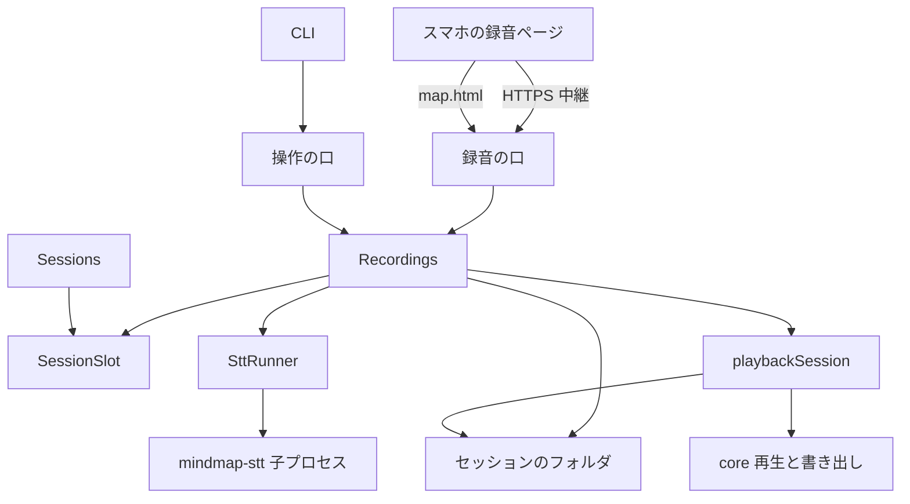
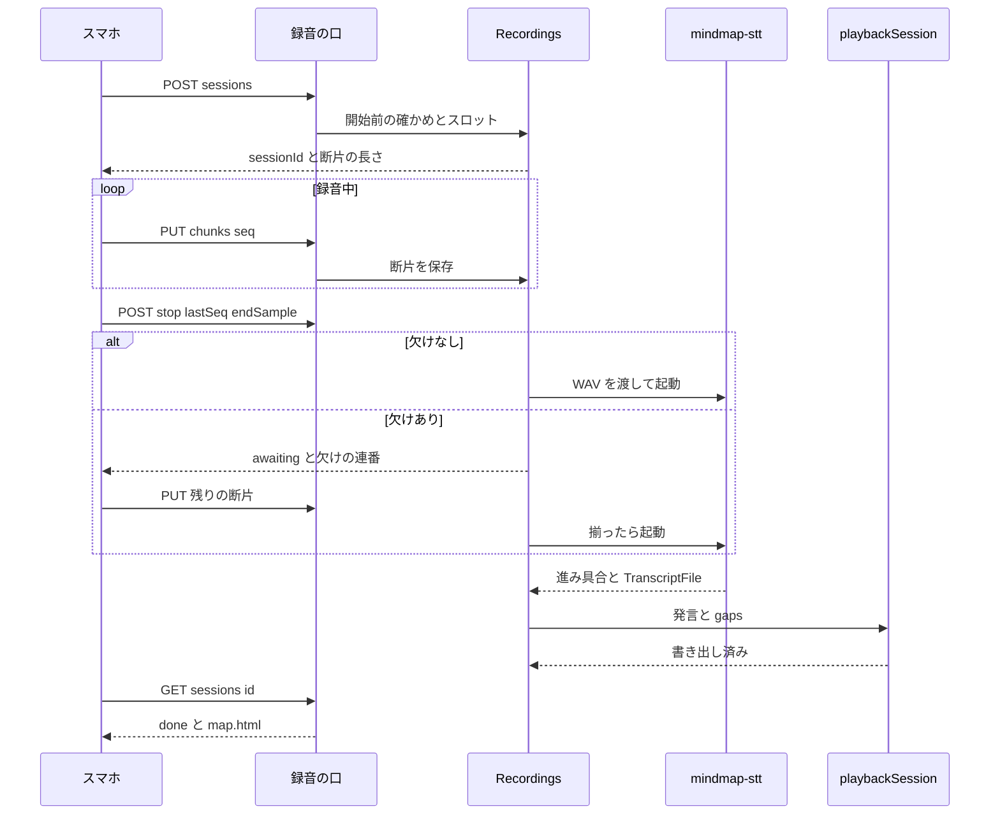
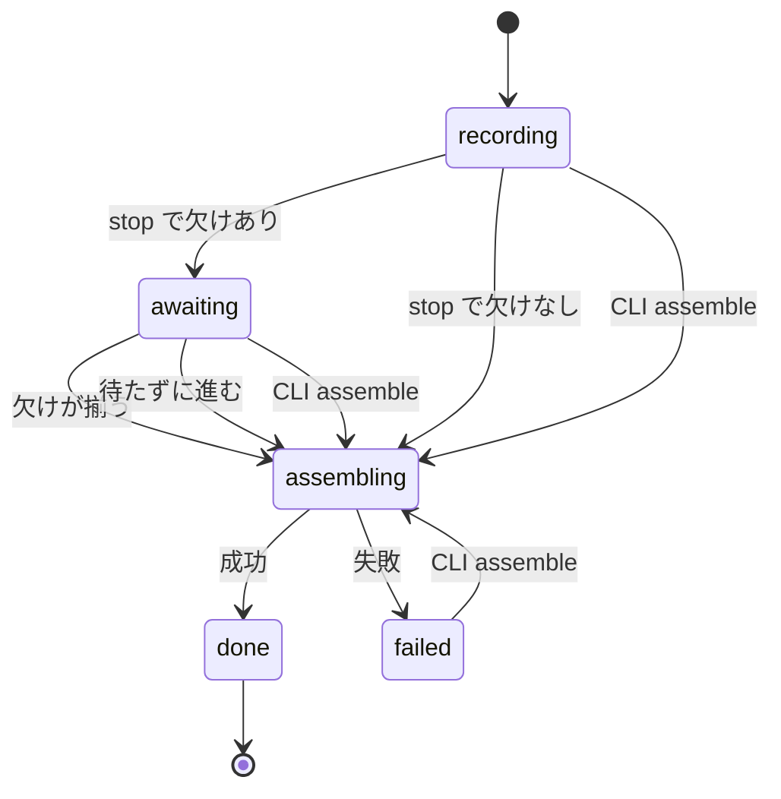

# Design Document

## Overview

スマホの録音は、PC の会議（ヘルパー）に並ぶ 2 つ目の入力である。利用者が、スマホのブラウザで対面の会議の音を録り、録音を止めたあとにマップを受け取る。音は録りながら 10 秒の断片に分けて、利用者のサーバーの「録音の口」へ送る。サーバーは断片をセッションのフォルダに残し、止めたあとに文字にして、`再生` と同じ経路でマップを組み立てる。会議の最中にはマップは育たない（ADR 0007、0008）。

**Purpose**: PC を開かずに、会議アプリを通さない対面の会議をマップにする。
**Users**: 会議を開く利用者 1 人。スマホで開始・停止・待ち・閲覧をし、削除・再実行・救出は CLI で行う。
**Impact**: server に録音の口・録音の状態機械・STT の子プロセスの起動を足す。web に録音のページを足す。ヘルパーの文字起こし部分を、Windows に依存しない実行ファイル（`mindmap-stt`）として切り出す。`Track` に `部屋` を足し、エクスポートに取り込みの途切れを出す。PC の会議の経路は変えない。

### Goals
- 要件 1〜11 を満たす。録音の口は、閲覧の口とは別の認証で守る
- 録音のセッションが、既存の発言・差分更新・ログ・エクスポートの形でそのまま残る
- サーバーの再起動、電波の断、組み立ての失敗から、音声を失わずに戻れる

### Non-Goals
- ライブ型、`部屋` の声を人ごとに分けること、プッシュ通知、複数の利用者
- 音声の保持期間による自動削除、スマホの画面からの音声の削除
- map.html・map.drawnix への取り込みの途切れの印
- PWA のインストール（manifest・service worker）。実機の検証の結果で必要になれば足す

## Boundary Commitments

### This Spec Owns
- 録音の口（認証・経路・ページの配信）と、録音のセッションの状態機械・永続（`recording.json`）
- 断片の受け取り・保存・欠けの判定、止めたあとの WAV の組み立て、`mindmap-stt` の起動と進み具合の取得
- 録音のセッションの発言を、既存の `再生` の経路でマップにして書き出すこと
- 録音のセッションの音声の削除と、組み立ての再実行・途切れた録音の組み立て（CLI）
- スマホの録音ページ（Foldkit のアプリ）と、その音の取得・保持・送信の部品
- `mindmap-stt`（切り出した文字起こしの実行ファイル）
- `Track` の `部屋`、エクスポートの `gaps`、`SessionSlot`

### Out of Boundary
- PC の会議の経路（ヘルパーの音の取得・AEC・`自分`/`相手` のトラック・音声を残さないこと）の振る舞い
- 閲覧の共有（見るだけの口、PIN）。録音の口はこれと独立
- 差分更新の中身（プロンプト・モデル・設定）と `map-update-latency` の仕組み
- 話者を声で分けること（`speaker-attribution`）、`部屋` に複数人がいる場合の扱い
- `tailscale serve` や HTTPS の用意、ネットワークの閉じ方（運用）
- 画面オフ録音が不可の場合のネイティブのラッパーの実装（同じ契約を使うが、別の仕様にする）

### Allowed Dependencies
- server の core（`map`・`session`・`playback`・`export`・`transcript`・`remark`）と、`sessionFiles`・`sessionSinks`・`modelSelection`・`config`・`startupCheck` の公開された部品
- `effect`（Schema・Service・Layer・`effect/process`・`HttpRouter`）。`runPromise` は入口だけ
- C#: `org.k2fsa.sherpa.onnx` 1.13.8、`NAudio.Core` 2.2.1（`NAudio` 本体は使わない）
- 禁止: core から録音の口・CLI・web への import。`web/src/recording` から server の core の barrel と `recordingProtocol.ts` の型以外の import。`stt/` から `helper/` の Windows 専用ファイルへのリンク

### Revalidation Triggers
- `recordingProtocol.ts` の経路・本文・状態の変更（ページとネイティブのラッパーの両方に効く）
- `SessionSlot` の取り方の変更（`Sessions` と `Recordings` の両方）
- `TranscriptFile` の形、`mindmap-stt` の標準出力・引数の変更
- `Track`・`JsonExport`・`IntakeLogEvent` の変更（web・エクスポート・復元）
- ヘルパーの `Resampler`・`ModelPaths`・`SttFile` の変更（`mindmap-stt` と共有）
- `recording.json` の形の変更（起動時の復元）

## Architecture

### Existing Architecture Analysis
- server は純粋な `core/` と外側（`sessions.ts`・`http.ts`・`cli.ts`）の 2 層。入口は `server.ts` と `cli.ts` だけで、Effect の実行は入口にしか置かない（`structure.md`）
- 同時 1 セッションは `Sessions` の状態機械（`idle | starting | live | stopping`）。`Live` はヘルパーの取り込みを前提にした形で、広げずに別の部品で守る
- 操作の口は 127.0.0.1 固定、閲覧の口は PIN と Cookie（`openViewingPort`）。本文をバイナリで受ける口は無い
- `play` の `recordPlayback` は `cli.ts` の非公開関数で、操作の口を自分で開く。サーバーの中から呼ぶには、口を開く部分と切り離して公開する
- ヘルパーの `SttFile` は、WAV を文字起こしして `cli play` 用の `TranscriptFile` を書く。これが録音後型の入口に使える

### Architecture Pattern & Boundary Map



**Architecture Integration**:
- Selected pattern: 録音専用の口 + 状態機械（`Recordings`）。ヘルパーの `Sessions` には載せず、共有の `SessionSlot` だけを足す
- Domain boundaries: `Recordings` は録音のセッションの状態・保存・組み立てを持つ。`Sessions` はヘルパーの取り込みを持つ。両者は `SessionSlot` 以外で互いを知らない
- Existing patterns preserved: core は純粋、外側が Service/Layer で本物を差す。経路は `{ method, path, body?, response }`。子プロセスは `effect/process`。テストの 3 層
- New components rationale: 録音の口（別の認証が要る）、`Recordings`（状態と永続）、`SttRunner`（子プロセスの境界）、`playbackSession`（口を持たない組み立て）、`SessionSlot`（2 経路の排他）
- Steering compliance: 外側 → core の依存の向き、`runMain`/`runPromise` の置き場、`*.test.ts` の層、日本語のコメント

### Technology Stack

| Layer | Choice / Version | Role in Feature | Notes |
|-------|------------------|-----------------|-------|
| Frontend | Foldkit + Effect 4（既存）、AudioWorklet、Screen Wake Lock、IndexedDB | 録音ページ。16 kHz Int16 PCM を作り、保持して送る | 新しい依存は無い。ブラウザの API だけ |
| Backend | TypeScript 7 / Node 22 / effect（既存） | 録音の口・状態機械・WAV の組み立て・子プロセスの起動 | `effect/process` の `ChildProcessSpawner` |
| STT | C# .NET 10（`net10.0`）、sherpa-onnx 1.13.8、NAudio.Core 2.2.1 | `mindmap-stt`：WAV → `TranscriptFile` | Linux x64/arm64。モデルは既存と同じ Zipformer + silero VAD |
| Storage | セッションのフォルダ（ファイル） | `audio/*.pcm`、`recording.json`、`log.jsonl`、書き出し | DB は使わない |
| Infrastructure | 常時起動の Linux、`tailscale serve`（運用） | 録音の口を tailnet の HTTPS に出す | 口は 127.0.0.1。LAN に開かない |

## File Structure Plan

### Directory Structure
```
server/src/
├── core/
│   └── recording.ts          # 純粋: RecordingMeta・状態遷移・欠けの数え方・進み具合・WAV の構成・本文の Schema
├── recordingProtocol.ts      # 録音の口の経路 {method,path,body?,response}。import は effect の Schema と core だけ（web と共有）
├── recordings.ts             # Recordings Service: 作成・断片の受領・停止・待たずに進む・組み立て・削除・起動時の復元
├── recordingPort.ts          # 録音の口: 認証（鍵+Cookie）・Origin 検査・経路・ページの配信・map.html
├── recordingPage.ts          # 録音ページの単一 HTML をビルド/配信（review.ts と同じ作り）
├── sttRunner.ts              # SttRunner Service: mindmap-stt の子プロセス。標準出力から進み具合、JSON から発言
├── sessionSlot.ts            # SessionSlot Service: idle | pc | recording の排他
├── playbackSession.ts        # cli.ts の recordPlayback を口なしで公開: 発言の列 → マップ → 書き出し（gaps 付き）
server/test/
├── recording.test.ts         # core/recording.ts の unit
├── recordings.it.test.ts     # 本物のファイル + 偽の SttRunner: 受領・停止・欠け・復元
├── recordingPort.it.test.ts  # 本物のソケット: 認証・Origin・冪等・状態
├── sttRunner.heavy.test.ts   # 本物の mindmap-stt と短い WAV
├── fixtures/fake-stt.ts      # 偽の mindmap-stt（標準出力と JSON を返す）
stt/
├── mindmap-stt.csproj        # net10.0。helper の Transcription/*・Events.cs・SttFile.cs・Audio/Resampler.cs・ModelPaths.cs をリンク
└── Program.cs                # file <wav> --transcript <json> [--track <名>] と check
helper/
├── Audio/Resampler.cs        # Capture.cs から移す（挙動は同じ）。TargetRate も持つ
└── ModelPaths.cs             # Check.cs から ModelDirectory と SttModel を移す（挙動は同じ）
web/
├── recording.html            # 録音ページの入口（単一 HTML のビルド対象）
└── src/
    ├── recording/            # ブラウザの API を包む純粋寄りの部品
    │   ├── captureWorklet.ts # AudioWorklet の処理（16 kHz Int16 へ。文字列として Blob から読む）
    │   ├── capture.ts        # getUserMedia・Wake Lock・無音の検知・run の開始位置
    │   ├── chunkStore.ts     # IndexedDB: 断片の保持・受領後の削除・連番の永続
    │   └── uploader.ts       # 再送ループ（指数バックオフ + online）・receivedThrough
    └── app/recording/        # Foldkit: entry・main・message・command・subscription・mount
```

### Modified Files
- `server/src/core/playback.ts` — 任意の `batchSeconds`（近い発言をまとめて流して、`idle` を待つ回数を減らす）。既定は無効
- `server/src/core/remark.ts` — `Track` に `部屋` を足す
- `server/src/core/transcript.ts` — `toTrack` が `"room"` を `部屋` にする
- `server/src/core/export.ts` — `JsonExport` に任意の `gaps`、`exportFiles` が map.md に「取り込みの途切れ」の節、map.json に `gaps`
- `server/src/core/intake.ts` — `IntakeLogEvent` に `intake-gap`
- `server/src/core/{captions,settle,people,personLine,speakers,speakerNames,map,drawnix,latency}.ts`、`remarkLine.ts`、`claudePrompt.ts`、`web/src/captions.ts` — `部屋` の網羅（話者を付けない・案の出した人を持たない・差分更新の発言の行に話者のラベルを付けない）。コンパイラの網羅性で拾う
- `server/src/sessions.ts` — 開始で `SessionSlot` を `pc` で取り、終了で放す。`status` に録音のセッションを出す
- `server/src/cli.ts` — `recordPlayback` を `playbackSession.ts` へ移して使う。`recording` の部分コマンド（`assemble <session>`・`delete-audio <session>`・`token`）
- `server/src/serverProtocol.ts` — 操作の口の経路 `recordingAssemble`・`recordingAudioDelete`、失敗の Schema
- `server/src/http.ts` — 失敗の `STATUS` の表に新しい失敗を足す
- `server/src/server.ts` — 起動時に `Recordings` の復元と録音の口の起動
- `server/src/config.ts` — `LIVE_MINDMAP_REC_PORT`（既定 4321）、`LIVE_MINDMAP_REC_HOST`（既定 127.0.0.1）、鍵の置き場
- `helper/Audio/Capture.cs`・`helper/Check.cs` — `Resampler`・`ModelDirectory` を移した分だけ削る
- `helper/SttFile.cs` — 書き出す `track` の値を引数にする（既定は `"microphone"`）
- `web/vite.config.ts`・`web/package.json` — 録音ページのビルド対象を足す
- `docs/adr/`・`CONTEXT.md` は変更済み

## System Flows



### 録音のセッションの状態



- スロットを持つ状態は `recording`・`awaiting`・`assembling`。`done`・`failed` で放す（要件 3.3、9.1）
- 起動時の復元: `recording`・`awaiting` はそのまま読み込み、スロットを取り直す（スマホが戻れば続きが届く）。`assembling` は `failed`（中断）にしてスロットは取らない（要件 6.2、9.1）
- 欠けた区間は、組み立ての時点で確定する。`stop` の `lastSeq` までに無い連番（`awaiting` の理由）と、録った範囲に覆われない区間（`gaps`）の 2 つは別のもの。後者は、マイクが止まっていた間も含む

## Requirements Traceability

| Requirement | Summary | Components | Interfaces | Flows |
|-------------|---------|------------|------------|-------|
| 1.1 | 開始操作で録り始める | Recorder Page、Recordings | POST sessions、Capture | 全体の流れ |
| 1.2 | 停止操作で止める | Recorder Page、Recordings | POST stop | 全体の流れ |
| 1.3 | 録音中と経過時間の表示 | Recorder Page | Model の recording 状態 | — |
| 1.4 | 画面オフ・ロック中も続く | Recorder Page（Capture） | Wake Lock、無音の検知、実機の検証（Task 1） | リスク |
| 1.5 | 続けられないときの表示と保全 | Capture、ChunkStore、Recorder Page | onmute・readyState、IndexedDB | — |
| 1.6 | 別の口と認証 | Recording Port | 鍵 + Cookie | — |
| 1.7 | 未認証は受けない | Recording Port | 401 | — |
| 1.8 | 閲覧の PIN では通らない | Recording Port、既存の閲覧の口 | 別の鍵、別のポート | — |
| 2.1 | 開始前の確かめ | Recording Port、Recorder Page | GET check、`mindmap-stt check` | 全体の流れ |
| 2.2 | 欠けていれば始めない | Recordings、Recorder Page | 412 と items | — |
| 2.3 | 自動で入れない | Recordings | （入れる処理を持たない） | — |
| 3.1 | 録音の開始を断る | SessionSlot、Recordings | 409 busy | — |
| 3.2 | PC の開始を断る | SessionSlot、Sessions | SessionBusy | — |
| 3.3 | 組み立てが終わると放す | Recordings、SessionSlot | 状態遷移 | 状態図 |
| 4.1 | 録りながら送る | Uploader、Recording Port | PUT chunks | 全体の流れ |
| 4.2 | 電波が切れたら保持 | ChunkStore、Uploader | IndexedDB | — |
| 4.3 | 戻ったら順に送る | Uploader | 再送ループ | — |
| 4.4 | 未送信の表示 | Recorder Page | pendingChunks | — |
| 4.5 | 届いた時点で残す | Recordings | 一時ファイル → 改名 | — |
| 5.1 | 送り終えるまで待つ | Recordings、Recorder Page | awaiting、missing | 状態図 |
| 5.2 | 揃えば組み立てる | Recordings | 自動の遷移 | 状態図 |
| 5.3 | 待たずに進む | Recording Port、Recordings | POST proceed | 状態図 |
| 6.1 | 届かない区間は途切れ | core/recording、Recordings | computeGaps | — |
| 6.2 | 中断しても届いた分を残す | Recordings | recording.json、復元 | 状態図 |
| 6.3 | CLI で届いた分を組み立てる | CLI、Recordings | POST recordings assemble | 状態図 |
| 6.4 | 止まっていた間の扱い | core/recording | computeGaps | — |
| 6.5 | 音声が無ければ始めない | Recordings | NoAudio | — |
| 7.1 | 音声を残す | Recordings | audio/ | — |
| 7.2 | CLI で消す | CLI、Recordings | DELETE recordings audio | — |
| 7.3 | 消しても記録を残す | Recordings | audio/ だけ消す | — |
| 7.4 | 進行中は消さない | Recordings | 409 | — |
| 7.5 | 無ければ何もしない | Recordings | NoAudio | — |
| 7.6 | PC では残さない | （変更しない） | — | — |
| 8.1 | 文字にして発言を作る | SttRunner、mindmap-stt | TranscriptFile | 全体の流れ |
| 8.2 | トラックは部屋、話者なし | core/transcript、Track | toTrack | — |
| 8.3 | 再生と同じ経路 | playbackSession | assembleFromRemarks | 全体の流れ |
| 8.4 | 進み具合を出す | SttRunner、Recording Port | progress | — |
| 8.5 | 組み立て中は進行中 | SessionSlot | 状態図 | 状態図 |
| 8.6 | 記録を残す | playbackSession | openLoggedSession | — |
| 8.7 | 出した人を持たない | core（`部屋`の網羅） | map・claudePrompt | — |
| 8.8 | 音声を外に出さない | SttRunner | 子プロセスはローカル | — |
| 9.1 | 失敗の表示と放す | Recordings | failed | 状態図 |
| 9.2 | 失敗でも音声を残す | Recordings | audio/ を消さない | — |
| 9.3 | CLI で再実行 | CLI、Recordings | POST recordings assemble | 状態図 |
| 9.4 | 別のセッションがあれば断る | SessionSlot | 409 | — |
| 9.5 | 音声が無ければ断る | Recordings | NoAudio | — |
| 10.1 | マップを開ける | Recording Port | GET map.html | 全体の流れ |
| 10.2 | 終えて書き出す | playbackSession | writeSessionExports | 全体の流れ |
| 10.3 | 途切れの印 | core/export | gaps | — |
| 10.4 | 同じ形式 | playbackSession | 既存の書き出し | — |
| 11.1 | PC の経路を変えない | （ヘルパーはファイル移動のみ） | — | — |
| 11.2 | PC のセッションに影響しない | SessionSlot、Recording Port | 断るだけ | — |

## Components and Interfaces

| Component | Domain/Layer | Intent | Req Coverage | Key Dependencies (P0/P1) | Contracts |
|-----------|--------------|--------|--------------|--------------------------|-----------|
| core/recording | core | 状態遷移・欠け・進み具合・WAV の構成・本文の Schema | 5.1, 5.2, 6.1, 6.4, 8.4 | core/remark（P0） | State |
| Recordings | server | 録音のセッションの作成・受領・停止・組み立て・削除・復元 | 1.1, 1.2, 2.2, 3.1, 4.5, 5, 6, 7, 9 | SessionSlot（P0）、SttRunner（P0）、playbackSession（P0） | Service, State |
| Recording Port | server | 録音の口: 認証・経路・ページ・map.html | 1.6〜1.8, 2.1, 10.1 | Recordings（P0） | API |
| SttRunner | server | `mindmap-stt` の子プロセス、進み具合、発言の読み出し | 8.1, 8.4, 8.8 | mindmap-stt（P0） | Service |
| SessionSlot | server | `idle | pc | recording` の排他 | 3.1〜3.3, 8.5, 9.4, 11.2 | — | Service |
| playbackSession | server | 発言の列 → マップ → 書き出し（gaps 付き） | 8.3, 8.6, 10.2〜10.4 | core（P0） | Service |
| mindmap-stt | stt（C#） | WAV → `TranscriptFile` | 8.1 | sherpa-onnx（P0） | CLI |
| Recorder Page | web | 録音の操作・表示 | 1.1〜1.5, 2.1, 4.4, 5.1, 5.3, 8.4, 10.1 | Recording Port（P0） | State |
| Capture / ChunkStore / Uploader | web | 音の取得・保持・送信 | 1.4, 1.5, 4.1〜4.3 | ブラウザ API（P0） | — |

### server

#### core/recording

| Field | Detail |
|-------|--------|
| Intent | 録音のセッションの純粋な規則と形 |
| Requirements | 5.1, 5.2, 6.1, 6.4, 8.4 |

**Responsibilities & Constraints**
- `Node` の型に触れない（`types: []` の tsconfig）
- 状態遷移は表で持ち、許されない遷移は値を返して失敗にする（`Result` は使わず、呼び出し側が `Effect` の失敗にする）

```typescript
export const RECORDING_SAMPLE_RATE = 16_000;
export const CHUNK_SECONDS = 10;

export type RecordingState = "recording" | "awaiting" | "assembling" | "done" | "failed";

export type RecordingMeta = {
  readonly id: string;                 // セッションのフォルダ名
  readonly title: string;
  readonly model: ExecutableModel;
  readonly createdAt: string;          // ISO
  readonly state: RecordingState;
  readonly stop?: { readonly lastSeq: number; readonly endSample: number; readonly at: string };
  readonly failure?: { readonly stage: "transcribe" | "map" | "export" | "interrupted"; readonly message: string };
};

export type ChunkRef = { readonly seq: number; readonly startSample: number; readonly samples: number };
export type Gap = { readonly start: number; readonly end: number };   // 秒（セッションの先頭から）

export function missingSeqs(chunks: readonly ChunkRef[], lastSeq: number): readonly number[];
export function computeGaps(chunks: readonly ChunkRef[], endSample: number): readonly Gap[];
export function receivedThrough(chunks: readonly ChunkRef[]): number;     // 連続して届いた最後の連番（無ければ -1）
export function nextState(state: RecordingState, event: RecordingEvent): RecordingState | NotAllowed;
export function transcribeProgress(lastFinalEnd: number, totalSeconds: number): number;   // 0〜1
export function wavHeader(pcmBytes: number): Uint8Array;                  // 16 kHz・モノラル・16 bit の 44 バイト
```
- Preconditions: `chunks` は `seq` の昇順・重複なし
- Postconditions: `computeGaps` は、重ならず昇順の区間を返す。端の 0.1 秒未満の欠けは数えない
- Invariants: `computeGaps` の区間の合計 + 覆われた長さ = `endSample / 16000`

#### Recordings

| Field | Detail |
|-------|--------|
| Intent | 録音のセッションの一生（作成から書き出しまで）の唯一の持ち主 |
| Requirements | 1.1, 1.2, 2.2, 3.1, 4.5, 5.1〜5.3, 6.1〜6.5, 7.1〜7.5, 9.1〜9.5 |

**Responsibilities & Constraints**
- セッションのフォルダは `createSessionDir` で作る。`recording.json` を状態が変わるたびに書く（一時ファイル → 改名）
- 断片は `audio/<seq 8 桁>-<startSample>.pcm` に、一時ファイルへ書いてから改名する。同じ連番が既にあれば何もしない（冪等）
- 組み立ては 1 本の fiber。スロットは `recording`・`awaiting`・`assembling` の間だけ持つ
- 失敗は `failure` に段階と文面を残す。音声は消さない

**Dependencies**
- Inbound: Recording Port、CLI の経路（P0）
- Outbound: SessionSlot（P0）、SttRunner（P0）、playbackSession（P0）、`createSessionDir`・`openLoggedSession`（P0）
- External: ファイルシステム（P0）

**Contracts**: Service [x] / State [x]

```typescript
interface Recordings {
  check(): Effect<RecordingCheck>;
  start(input: { title?: string; model?: ExecutableModel }): Effect<StartedRecording, SessionBusy | RecordingDepsMissing>;
  putChunk(id: string, chunk: { seq: number; startSample: number; pcm: Uint8Array }): Effect<ChunkAck, RecordingNotFound | RecordingNotOpen | InvalidChunk>;
  stop(id: string, stop: { lastSeq: number; endSample: number }): Effect<RecordingView, RecordingNotFound | RecordingNotOpen>;
  proceed(id: string): Effect<RecordingView, RecordingNotFound | RecordingNotOpen>;
  status(id: string): Effect<RecordingView, RecordingNotFound>;
  assemble(id: string): Effect<RecordingView, RecordingNotFound | SessionBusy | NoAudio | RecordingNotAssemblable>;   // CLI: 途切れた録音、失敗した録音
  deleteAudio(id: string): Effect<void, RecordingNotFound | RecordingActive | NoAudio>;
  restore(): Effect<void>;   // 起動時
}

type StartedRecording = { id: string; chunkSeconds: number; sampleRate: number };
type ChunkAck = { receivedThrough: number };
type RecordingView = {
  id: string; state: RecordingState; elapsedSeconds: number;
  missing: readonly number[];                       // awaiting のときの欠けた連番
  phase?: "transcribing" | "mapping"; transcribed?: number;   // 0〜1（8.4）
  failure?: { stage: string; message: string };
  mapReady: boolean;
};
```
- Preconditions: `putChunk` は `state` が `recording` か `awaiting` のときだけ。`pcm` の長さは偶数で 320,000 バイト以下
- Postconditions: `putChunk` が成功したら、その連番のファイルが残っている。`awaiting` で最後の欠けが揃ったら `assembling` へ進む
- Invariants: `done`・`failed` の間は、スロットを持たない。`audio/` を消した後は `assemble` を受けない（`NoAudio`）

##### State Management
- 状態の正は `recording.json`。メモリには、動いている組み立ての fiber とスロットだけを持つ
- `stop` の受け付けは冪等（同じ `lastSeq`・`endSample` なら同じ結果）。`stop` の後に断片が来ても、`lastSeq` 以下の欠けだけを受ける

**Implementation Notes**
- Integration: `assemble` は、`recording`・`awaiting`（`stop` なし）なら、受け取った最大の `startSample + samples` を `endSample` にして止める。`failed` なら音声から組み立て直す。`done` は受けない
- Validation: 組み立ての前に `audio/` に断片が 1 つも無ければ `NoAudio`
- Risks: 組み立ての時間（`playback` は発言ごとに差分更新の完了を待つ）。1 時間の会議で実測する

#### Recording Port

| Field | Detail |
|-------|--------|
| Intent | スマホ向けの口。閲覧の口とは別の鍵で守る |
| Requirements | 1.6, 1.7, 1.8, 2.1, 10.1 |

**Responsibilities & Constraints**
- `LIVE_MINDMAP_REC_HOST:LIVE_MINDMAP_REC_PORT` で待ち受ける（既定 127.0.0.1:4321）。サーバーの起動時から常に開く
- 鍵はサーバーが `~/.live-mindmap/recording-token`（乱数 32 バイトの 16 進）に作る。無ければ作る。閲覧の PIN や操作の口の値とは無関係
- `GET /?token=<鍵>` が一致したら Cookie `mindmap-rec`（HttpOnly、SameSite=Strict、`X-Forwarded-Proto` が https のとき Secure、1 年）を付けて `/` へ 303。比較は `timingSafeEqual`
- 鍵は Cookie のほかに `Authorization: Bearer <鍵>` でも受ける（同じ値、同じ `timingSafeEqual`）。ブラウザ以外のクライアント（画面オフ録音が不可だった場合のネイティブのラッパー）が、同じ契約をそのまま使える
- 鍵の無い（Cookie も Bearer も無い）`/rec/*` は 401。`/` も 401（短い案内の文面だけ）
- 状態を変える要求（PUT/POST）の `Origin` の扱い: Cookie で通る要求は、`Origin` があって、そのホスト部が `Host` と同じことを要求する（スキームは見ない。TLS を中継が終えるため）。Bearer で通る要求は `Origin` を見ない（鍵を知っている非ブラウザのクライアントのため。ブラウザは Bearer を自動で付けない）
- 本文の上限は 1 MiB。バイナリの本文は `application/octet-stream`

**Contracts**: API [x]

##### API Contract

| Method | Endpoint | Request | Response | Errors |
|--------|----------|---------|----------|--------|
| GET | /?token= | — | 303 + Set-Cookie | 401 |
| GET | / | — | 録音ページ（単一 HTML） | 401 |
| GET | /rec/check | — | `RecordingCheck` | 401 |
| POST | /rec/sessions | `{ title?: string }` | 201 `StartedRecording` | 401, 409 busy, 412 deps |
| PUT | /rec/sessions/:id/chunks/:seq | PCM のバイト列。ヘッダー `X-Start-Sample` | 200 `ChunkAck` | 400, 401, 404, 409 not-open |
| POST | /rec/sessions/:id/stop | `{ lastSeq, endSample }` | 200 `RecordingView` | 400, 401, 404, 409 |
| POST | /rec/sessions/:id/proceed | — | 200 `RecordingView` | 401, 404, 409 |
| GET | /rec/sessions/:id | — | `RecordingView` | 401, 404 |
| GET | /rec/sessions/:id/map.html | — | 書き出した map.html | 401, 404（まだ） |

- 冪等性: 同じ `seq` の `PUT` は、中身が違っても最初の 1 件を残して `200`（`receivedThrough` を返す）
- `RecordingCheck` は `{ items: [{ name: "stt-runner" | "stt-model" | "updater-auth", state: "ready" | "missing" }] }`
- 経路と Schema は `recordingProtocol.ts` に置き、ページが型を共有する

#### SttRunner

| Field | Detail |
|-------|--------|
| Intent | `mindmap-stt` を子プロセスとして起動し、進み具合と結果を取る |
| Requirements | 8.1, 8.4, 8.8 |

**Contracts**: Service [x]

```typescript
interface SttRunner {
  check(): Effect<{ runner: "ready" | "missing"; model: "ready" | "missing" }>;
  transcribe(input: { wav: string; transcriptPath: string; totalSeconds: number }): Stream<number, SttFailed>;   // 進み具合（0〜1）を流し、終わったら transcriptPath に TranscriptFile がある
}
```
- 実行ファイルの場所は `LIVE_MINDMAP_STT`、無ければサーバーの隣（`helperPath.ts` と同じ作り）
- 標準出力は 1 行 1 イベントの JSON（`Events.Remark`）。確定結果の `end`（秒）を `transcribeProgress` に渡す。標準エラーの末尾を失敗の文面に使う
- 終了コード 0 以外、または `transcriptPath` が無ければ `SttFailed`
- 子プロセスはサーバーの Scope に結ぶ。サーバーの停止で止める

#### SessionSlot

```typescript
type SlotKind = "pc" | "recording";
type SlotHolder = { readonly kind: SlotKind; readonly id?: string };   // 録音のときは、セッションのフォルダ名
interface SessionSlot {
  acquire(holder: SlotHolder): Effect<void, SessionBusy>;   // 空いていなければ、持っている側（種類と id）を添えて失敗
  release(kind: SlotKind): Effect<void>;
  holder(): Effect<SlotHolder | undefined>;
}
```
- `SessionBusy` の文面: 録音のセッションが持っているときは、「録音のセッション `<id>` が進行中です。録音が残っているだけなら `recording assemble <id>` で届いた分を組み立てて解除できます」。PC のセッションが持っているときは、今の文面のまま
- `status`（CLI と `GET /status`）に、録音のセッションがあれば `recording: { id, state }` を出す。`/mindmap-start` が断られたとき、何が塞いでいるかを `status` でも確かめられる
- `Sessions.begin` が `acquire({ kind: "pc" })`、`stopLive` の終わりで `release("pc")`。`Recordings` は `start` と起動時の復元で `acquire({ kind: "recording", id })`、`done`・`failed` で `release("recording")`
- `SessionBusy` は既存の失敗を使い、持っている側（`kind` と `id`）を足す

#### playbackSession

```typescript
function assembleFromRemarks(input: {
  dir: string; title: string; model: ExecutableModel;
  remarks: readonly PlaybackRemark[]; gaps: readonly Gap[]; batchSeconds?: number;
}): Effect<{ exported: readonly string[] }, ExportFailed, DiffUpdater | FileSystem | ReviewBuild>;
```
- `cli.ts` の `recordPlayback` から、口を開く部分を除いて移す。`cli play` はこれを呼ぶ形に直す（振る舞いは同じ）
- 既存のフォルダ（`createSessionDir` 済み）に、`log.jsonl`・`export.json`・書き出し 4 つを作る。`gaps` は `intake-gap` として log に追記し、`JsonExport.gaps` に渡す
- 更新のモデルの Layer は、`Sessions` と同じ手順（`sinks.prepare(model)`）で作る。呼び出しの結線は実装で確かめる

#### 取り込みの途切れの出し方（export）
- `JsonExport` に `gaps?: readonly { start: number; end: number }[]`（秒）。無ければ欄ごと付けない
- map.md の末尾に「## 取り込みの途切れ」の節を足し、`mm:ss–mm:ss` の一覧を書く。無ければ節を出さない
- 発言の時刻の基準は、セッションの先頭（音声の先頭）

### stt（C#）

#### mindmap-stt

| Field | Detail |
|-------|--------|
| Intent | WAV を文字にして `TranscriptFile` を書く |
| Requirements | 8.1 |

**Contracts**: CLI [x]

- `mindmap-stt file <wav> --transcript <path> [--track <名>]`: `SttFile.Run` を呼ぶ。`--track` の既定は `microphone`（録音は `room` を渡す）
- `mindmap-stt check`: `{"sttModel":"ready"|"missing"}` を標準出力に出す。`ModelPaths` を使う
- 標準出力は `Events.Remark` の行。標準エラーに RTF を出す
- `stt/mindmap-stt.csproj` は `net10.0`。`Compile Include` で `..\helper\Transcription\*.cs`・`..\helper\Events.cs`・`..\helper\SttFile.cs`・`..\helper\Audio\Resampler.cs`・`..\helper\ModelPaths.cs` を取り込む。`NAudio.Core` と `org.k2fsa.sherpa.onnx` だけを参照する
- 配布は Linux x64/arm64 の self-contained（`dotnet publish -r linux-x64`）。Releases に載せるかは別の判断（ADR 0006 の延長）

### web

#### Recorder Page（Foldkit）

| Field | Detail |
|-------|--------|
| Intent | 録音の開始・停止・待ち・閲覧を 1 つの画面で |
| Requirements | 1.1〜1.5, 2.1, 4.4, 5.1, 5.3, 8.4, 10.1 |

**State**
```typescript
type Phase =
  | "idle" | "checking" | "check-failed" | "recording" | "sending"      // sending: 停止後、未送信を送っている
  | "awaiting-server" | "assembling" | "done" | "failed";
type Model = {
  phase: Phase; sessionId?: string; elapsedSeconds: number;
  pendingChunks: number; mic: "ok" | "denied" | "silent" | "stopped";
  progress?: { phase: "transcribing" | "mapping"; transcribed: number };
  missing: readonly string[]; failure?: string;
};
```
- 画面は 1 つ。`recording` で経過時間と未送信の数、`sending` で残りと「待たずに進む」、`assembling` で文字にし終えた割合、`done` で「マップを開く」（`/rec/sessions/:id/map.html`）
- Message は動詞で始まる過去形の事実（`StartedRecording`・`ChunkAcked`・`MicWentSilent` など）。`NoOp` は使わない
- 実装の副作用は、`web/src/recording/*` を包んだ Command にする。ポーリングは Subscription（2 秒）

#### Capture / ChunkStore / Uploader（`web/src/recording/`）
- **Capture**: `getUserMedia({ audio: { echoCancellation: false, noiseSuppression: false, autoGainControl: false } })`。`AudioContext({ sampleRate: 16000 })` を要求し、実際の値が違えばワークレットの中で 16 kHz に落とす。ワークレットは 10 秒ごとに Int16 の断片を渡す。**run の開始位置**（セッションの開始からの経過サンプル）を断片ごとの `startSample` に足す。再読み込みの後に取り直した run は、経過時間の分だけ位置が進み、その間が `gaps` になる
- **Wake Lock**: 録音中に取り、`visibilitychange` で取り直す。取れなければ画面に注意を出す
- **無音の検知**: `track.onmute`・`readyState`・ワークレットの音量が一定時間 0 のとき `MicWentSilent`（要件 1.5）。断片は無音のままでも送る（欠けとは別に、サーバーは音として残す）
- **ChunkStore**: IndexedDB に `{sessionId, seq, startSample, pcm}` を書いてから送る。受領（`receivedThrough` 以下）で消す。連番と `sessionStartedAt` も永続する。`navigator.storage.persist()` を要求する
- **Uploader**: 未送信を連番の昇順で送る。失敗は指数バックオフ（上限 30 秒）と `online` で再開。`stop` の応答の `missing` に当たる断片は優先して送る

### CLI（操作の口）

| 経路 | CLI | 振る舞い |
|------|-----|----------|
| POST /recordings/:id/assemble | `recording assemble <session>` | 要件 6.3、9.3。`Recordings.assemble` |
| DELETE /recordings/:id/audio | `recording delete-audio <session>` | 要件 7.2〜7.5。`Recordings.deleteAudio` |
| （ファイルを読むだけ） | `recording token` | 鍵を標準出力に出す。録音のページの最初の URL は `https://<tailnet の名前>/?token=<鍵>` |

- `<session>` はセッションのフォルダ名（`start` が返すものと同じ）。省略は不可（消す・組み立てるを取り違えないため）
- 失敗の終了コードと文面は、既存の `ServerFailed` の作りに従う

## Data Models

### Domain Model
- 集約は録音のセッション 1 つ。断片は追記だけで、書き換えない。`recording.json` は状態の写しで、断片のファイルが正
- 不変条件: 断片の連番は録音のセッションの中で一意。`startSample` は非負。組み立ては `stop`（または `assemble`）で決まった `endSample` までを読む

### Physical Data Model（セッションのフォルダ）
```
<sessions>/<timestamp>/
├── recording.json        # RecordingMeta
├── audio/00000000-0.pcm  # 連番 8 桁-開始サンプル。Int16 リトルエンディアン・16 kHz・モノラル
├── audio/…
├── .assemble/audio.wav   # 組み立て中だけ。終わったら消す
├── .assemble/transcript.json
├── log.jsonl             # start・remark・intake-gap など（既存の形）
├── export.json
└── map.md / map.json / map.drawnix / map.html
```
- `.assemble/audio.wav` は、断片を `startSample` の位置に並べ、欠けた区間は無音で埋めて作る。時刻が音声の先頭からの秒と一致する
- 音声を消す（要件 7）のは `audio/` だけ。`recording.json`・ログ・書き出しは残す

### Data Contracts & Integration
- `TranscriptFile` は既存（`core/transcript.ts`）。録音は `track: "room"`、`start_seconds`・`end_seconds`・`text`
- `RecordingMeta`・`RecordingView`・本文の Schema は `core/recording.ts` と `recordingProtocol.ts`。外から来る値は Schema で検証する（`InvalidChunk`・`InvalidBody`）
- 起動時: `recording.json` が壊れていれば、そのセッションを読み込まず、ログに警告を出す（音声は残す）

## Error Handling

### Error Strategy
- 外から来る壊れ（本文・`recording.json`・子プロセスの出力）は `Effect<A, TaggedError>`。自分のコードとの約束違反は defect（`CODING_STANDARDS.md`）

### Error Categories and Responses
**User Errors**: 401（鍵なし）、400（本文が不正・上限超え）、404（セッションなし）、409（スロットが埋まっている、録音が開いていない、進行中の音声は消せない）、412（開始前の確かめで欠けている）。文面は「何が足りないか」「どれが進行中か」を含む
**System Errors**: `SttFailed`（子プロセスの失敗）、書き込みの失敗。`failed` にして音声を残し、`failure.stage` を示す
**Business Logic Errors**: `NoAudio`（組み立て・削除する音声が無い）、`RecordingNotAssemblable`（`done` を再実行しようとした）

### Monitoring
- 状態の遷移、断片の欠け、組み立ての段階ごとの所要時間を `log.jsonl` の外（サーバーのログ）に出す。音声の中身は出さない

## Testing Strategy

### Unit Tests（`*.test.ts`）
- `computeGaps`: 先頭の欠け・途中の欠け・末尾の欠け・重なる断片・端の 0.1 秒未満（要件 6.1、6.4）
- `missingSeqs` / `receivedThrough`: 連続・飛び・逆順の到着（要件 5.1、4.3）
- `nextState`: 許される遷移と、許されない遷移の網羅（要件 3.3、9.1）
- `wavHeader` と、欠けを無音で埋めた PCM の長さ（時刻が音声の先頭からの秒と一致すること）
- `transcribeProgress`: 0〜1 に収まり、減らない（要件 8.4）
- `exportFiles`: `gaps` がある・無いときの map.md と map.json（要件 10.3）

### Integration Tests（`*.it.test.ts`、本物のファイルとソケット、偽の `SttRunner`）
- 録音の口: 鍵なしで 401、Cookie ありで通る、閲覧の PIN の Cookie では通らない（要件 1.6〜1.8）
- 冪等な `PUT`、順序の違う到着、`stop` で欠けあり → `awaiting` → 残りが届いて自動で `assembling`（要件 4.5、5.1、5.2）
- 待たずに進む・CLI の `assemble` で、欠けが `gaps` になる（要件 5.3、6.3）
- `SessionSlot`: PC が進行中なら録音の開始が 409、録音中なら `Sessions.start` が失敗（要件 3.1、3.2、11.2）
- 起動時の復元: `recording` はスロットを取り直し、`assembling` は `failed`（中断）になる（要件 6.2、9.1）
- 組み立ての失敗 → `failed`・音声が残る → `assemble` で `done`。別のセッションが進行中なら断る（要件 9.1〜9.4）
- 音声の削除: `done` は消せて記録が残り、進行中は 409、無ければ `NoAudio`（要件 7.2〜7.5）

### 重い IT（`*.heavy.test.ts`）
- 本物の `mindmap-stt` で短い WAV を文字起こしし、`TranscriptFile` の形を確かめる（要件 8.1）
- web: Chromium の疑似マイク（`--use-fake-device-for-media-stream --use-file-for-fake-audio-capture`）で、録音ページの開始 → 断片の送信 → 停止 → 組み立て → map.html を通しで確かめる（要件 1.1、1.2、4.1、10.1）。`LIVE_MINDMAP_CHROMIUM` を使う

### 実測（自動化しない）
- **Task 0**: 既存の長めの文字起こしを `cli play` に通し、発言数・差分更新の回数・全体の時間を記録する。`batchSeconds` を変えて、時間と `cli evaluate` の品質を比べる

### 実機の検証（自動化しない）
- **Task 1**: Android の Chrome で、画面を点けたまま・画面オフ・ロックの 3 条件を 30〜60 分ずつ録り、`visibilitychange`・`onmute`・音量のログと、サーバーに届いた断片の連続性を見る。結果で要件 1.4 の方式（ページ / ネイティブのラッパー）を決める
- `tailscale serve` 越しで Cookie の `Secure`・`Origin` の扱いと、マイクの許可が通ること

## Security Considerations
- 録音の口は 127.0.0.1 に結び、外へ出すのは運用の `tailscale serve`。鍵は 32 バイトの乱数で、`timingSafeEqual` で比べ、ファイルに置く（Windows 以外は 0600）
- 閲覧の PIN・Cookie（`mindmap-view`）と、録音の鍵・Cookie（`mindmap-rec`）は別。録音の口は閲覧の画面を配らず、閲覧の口は録音の経路を持たない
- Cookie で通る状態を変える要求は、Cookie（SameSite=Strict）と Origin のホスト部の検査の両方を通す。Bearer で通る要求は鍵そのものが証明（ブラウザの他のページは、鍵を知らないので付けられない）
- 音声は、利用者のサーバーの外に出さない。外に出るのは差分更新のための発言の文字だけ（既存と同じ、要件 8.8）
- 鍵が漏れたときは、鍵のファイルを消して再起動する（再生成）。Cookie は無効になる

## Performance & Scalability
- 断片は 320 KB（10 秒）。2 時間の会議で約 230 MB のスマホ側の保持と送信
- STT の速度は PC の CPU で RTF 0.03〜0.11（ADR 0001）。サーバーでの値は未測定
- **組み立ての時間の支配は差分更新**: 待たない既定の `playback` は、発言を 1 つ流すたびに差分更新の完了を待つ（`core/playback.ts`）。時間は発言の数 × 1 回の更新の時間で、1 時間の会議（発言が数百件）で数十分になりうる。要件に時間の目標は置かないが、実用の限度を超えるなら価値が崩れるので、次の手順で抑える
  1. **最初に実測する**（Task 0）: 既存の長めの文字起こしを `cli play` に通して、発言数・更新の回数・全体の時間を記録する
  2. **まとめて流すオプション**: `playback` に `batchSeconds?: number` を足す。指定があれば、最初の発言の `start` から `batchSeconds` 秒以内の発言を続けて `push` し、1 回だけ `idle` を待つ。既定は無効（今までの `play` と同じ。`map-update-latency` の評価の前提を変えない）
  3. 録音の組み立てが使う値は、実測と、`cli evaluate` によるマップの品質の確認で決める。品質が落ちる値は採らない

## Migration Strategy
- 既存のデータの移行は無い。`Track` の `部屋` は追加で、既存の log.jsonl はそのまま読める
- 導入の順序: ヘルパーの 2 ファイルの移動 → `mindmap-stt` → core の変更 → server → web。ヘルパーのビルドと `check`、実会議の手動確認を、移動の直後に行う（要件 11.1）

## Open Questions / Risks
- 画面オフ録音（要件 1.4）: ページで足りない場合、要件の文面を改めるか、ネイティブのラッパー（別の仕様）で満たす。Task 1 の結果で決める
- 組み立ての時間: Task 0 の実測の結果で、`batchSeconds` の値（または使わない判断）を決める。品質が落ちる値は採らない
- 放置された録音がスロットを持ち続ける: 自動の期限は置かない（スマホが戻れば続きが届くため）。解除は `recording assemble` で、断りの文面と `status` が案内する
- 録音の口の本文の上限と、中継越しの Cookie/Origin: 実装で確かめる
- sherpa-onnx 1.13.8 のネイティブが、使う Linux の glibc で動くか: サーバーで確かめる
- `Track` の網羅で `部屋` の扱いが分かれる箇所（字幕・話者・差分更新の発言の行）: テストで固定する
